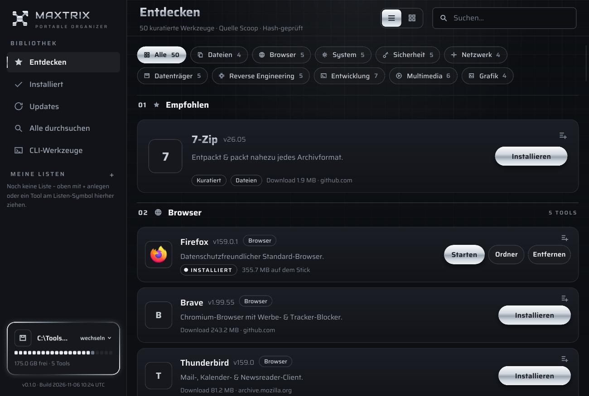

# Maxtrix Portable Manager

A portable tool launcher and library for your IT USB stick. It runs from the stick without
installation, downloads portable tools from their publishers, verifies them, keeps them up
to date and starts them with the right environment.



The user interface is currently in German. Windows only for now.

## Features

- **Curated catalog** of 50 portable tools, plus full-text search across the Scoop buckets
- **Verified downloads** from the official publisher URLs, checked against the manifest's
  checksum before anything is unpacked
- **Automatic dependencies**, for example a portable JDK for Ghidra
- **Updates that keep your data**: settings survive updates, and a failed or cancelled update
  leaves the old version working
- **Drive-independent**: paths are stored relative to the stick, so the drive letter can change
- **Terminal for command-line tools** with the tool on the `PATH`
- **Your own lists**, drag and drop, and a quick-launch window in the system tray

## Download

Get `PortableManager.zip` from the [releases page](../../releases), copy its contents to the
root of your stick and start `PortableManager.exe`.

The executable is not code-signed yet, so Windows SmartScreen may warn you on first start.
Release builds are made by GitHub Actions from the tagged source. You can check where a
file came from with `gh attestation verify PortableManager.zip --repo maxmlr76/Portable-Manager`.

## Build from source

You need a current stable [Rust](https://rustup.rs) toolchain.

```
cargo test -p maxtrix-engine
cargo build --release -p maxtrix-app
pwsh packaging/package.ps1
```

| Folder | Purpose |
|---|---|
| `crates/engine` | All logic: manifests, downloads, unpacking, updates |
| `crates/cli` | `maxtrix` command line for the engine |
| `crates/app` | The Slint desktop app |
| `packaging` | Builds the release package, fetches 7-Zip |

## Good to know

- **Search:** the full-text search uses the public, read-only search service behind
  [scoop.sh](https://scoop.sh). If it is unavailable, the search stays empty and the rest of
  the app keeps working.
- **Security tools:** the catalog includes tools such as Nmap and hashcat. Nothing is bundled;
  they are downloaded from their publishers on your request. Use them only on systems you own
  or are authorized to test.
- **No warranty:** see `LICENSE`. You decide what you install and run.

## License

The source code is under the [MIT license](LICENSE). The "Maxtrix" name and logo are excluded,
see [TRADEMARKS.md](TRADEMARKS.md). Bundled software is listed in
[THIRD-PARTY-NOTICES.txt](THIRD-PARTY-NOTICES.txt).

Built with [Slint](https://slint.dev):

[](https://slint.dev)
